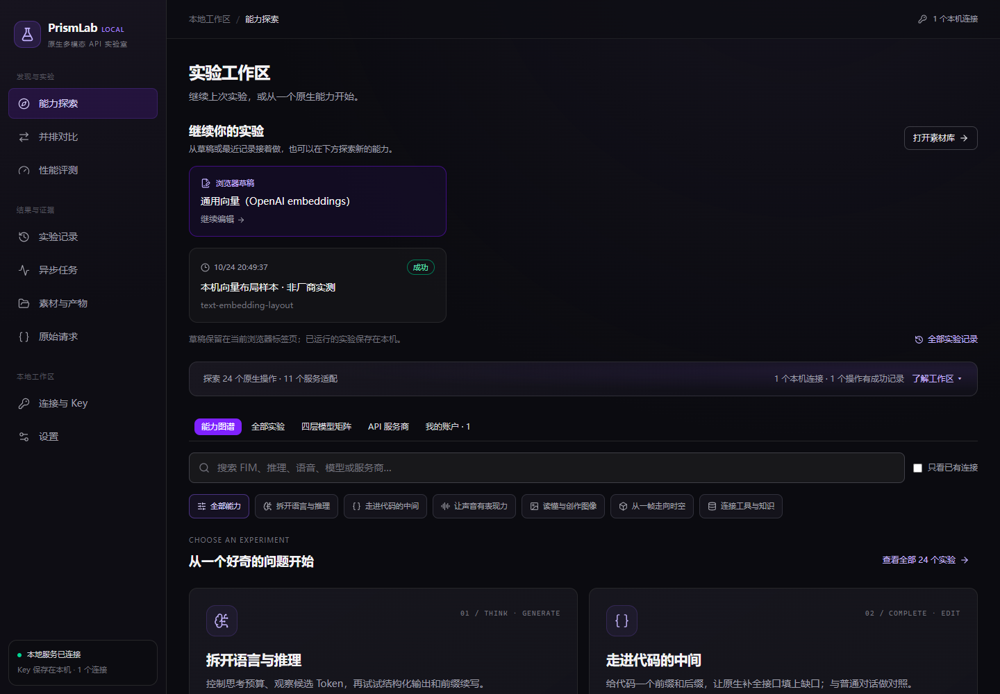

# PrismLab · 原生 AI API 实验室

本地运行的多模态 API 游乐场。按厂商或玩法发现能力，从友好表单进入原生参数、实际请求与事件，再保存、复用和并排比较实验。优先国内服务，保留各家的协议与能力差异。

融合了原 API Playground 的原生执行与本机持久化、PrismLab 的能力图谱与四层调用视图，以及 [usermbzlj/llm-bench](https://github.com/usermbzlj/llm-bench) 的真实性能引擎。源码来源、取舍与验收范围见 [融合说明](docs/fusion.md)。

## 启动

要求 Node.js **24 或以上**；本轮验证环境为 Node 26.12.0 / npm 12.2.0 / Windows。

```powershell
npm ci
npm run dev
```

打开 [开发入口](http://localhost:5173/#/explore)。API 默认监听 `127.0.0.1:8787`。首次进入「连接与 Key」添加服务，再从探索页载入实验预设。没有 Key 也能浏览能力、参数和请求预览。

构建后单端口运行：

```powershell
npm run build
npm start
```

打开 [本地构建入口](http://127.0.0.1:8787/#/explore)。这是本机地址，没有公网部署。关闭启动命令所在终端即可停止服务。

## 已有入口

当前注册 **11 个服务入口、24 个操作、25 个预设**，不是 24 项已通过真实账户验收。具体模型、官方来源、适配深度与条件见 [覆盖清单](docs/provider-coverage.md)。

| 服务 | 可玩的原生操作 |
| --- | --- |
| DeepSeek | 对话、前缀续写、FIM、Logprobs、工具与缓存观察 |
| MiniMax | 对话、TTS 情绪/音色/格式与流式音频、Hailuo 文图生视频、首尾帧视频 |
| Kimi | K3 推理强度、K2.6 思考开关、Preserved Thinking、工具与图像 |
| 小米 MiMo | 原生思考参数与采样生效诊断、专用音频转写 |
| Qwen / 百炼 | 思考预算、原生文生图/参考图编辑、实时双向语音与语义 VAD |
| 豆包 / 火山方舟 | Seed 原生推理档位、图像理解、模型与接入点 |
| Tripo | 文本到 3D、网格/材质种子、异步 GLB 与旋转缩放预览 |
| OpenAI 原生音频 | 文件转写、Realtime 双向音频 |
| Google Gemini | 原生内容生成、思考/签名、函数工具、搜索引用、结构化输出、单人/多人语音 |
| 自定义 OpenAI 兼容 | 对话、文本续写/FIM、Embedding、Rerank |
| 自定义 Anthropic 兼容 | Messages、思考块、工具与签名回传 |

状态含义：`documented` 有官方依据但未实测；`unverified` 尚待确认；`partial` 仅部分验证；`tested` 必须有真实调用证据。界面的本机成功/失败次数与目录声明分开呈现。

**验证边界**：部分 DeepSeek、MiMo、Kimi 和 MiniMax 文本操作有历史真实调用证据，其余能力按目录标记区分文档适配与实测范围。自动检查使用隔离数据和本地模拟服务，不调用付费推理。新安装从空工作区开始，不附带私人凭证、连接清单或实验记录。详情见 [验证说明](docs/verification.md)。

## 界面预览

下图使用明确标注的本机布局样本，不代表厂商实测或预装数据。



## 使用流程

工作区首页优先显示浏览器草稿与最近实验。输入、原生参数、原始请求和对比通道会在当前浏览器标签页自动保留；切换页面不会中断已开始的普通请求。全局运行栏可以返回结果或明确停止。刷新或关闭网页仍会中断 HTTP/SSE/实时连接，浏览器会在运行期间提示；已保存记录和服务端异步任务不依赖页面存活。

实验结果绑定实际发送时的输入，修改编辑器后会保留旧结果并提示尚未运行。探索筛选和历史筛选可随地址恢复；从实验台添加连接后可直接返回原草稿。手机布局提供固定运行、停止和结果入口。

“素材与产物”集中管理上传文件和生成结果，实验台可选择已有素材。删除历史只删除记录，文件保留在素材库；清理必须明确选择未引用文件，已保存实验、模板及当前标签页草稿使用中的文件受到保护。其他浏览器标签页的未保存草稿无法由本标签页识别，清理前需自行核对。

1. **连接与 Key**：管理多个账号/端点，选择直连或代理。可从环境变量或项目根目录的 `.env.local` 检测并导入 Key，也可选择 Markdown/TXT 凭证文件，预览后批量导入。浏览器列表只显示掩码。使用服务对应的地域与账户。
2. **探索**：在“已接入账户”中按服务与账号直接进入实验，或按模型和能力找入口。没有适配的能力诚实标为线索；原始请求台仍可尝试未知端点。
3. **实验台**：载入预设，填写文字或真实素材，勾选要发送的原生参数。请求预览与服务端使用同一份 `build()`；未勾选的参数不发送。
4. **观察与复用**：查看正文/思考/工具/Token 候选、原生字段、请求、事件、耗时与实际可得用量。保存预设，或从历史恢复完整参数开关、输入和素材引用。
5. **对比**：2–4 通道可选不同操作、连接、模型与参数；同类通道可复制相同输入。确认数量后才运行，历史按分组回看。不同协议的 Token、路由、缓存和参数语义不被当作完全等价。
6. **性能评测**：复用兼容连接与实验台请求，运行固定请求数、时长、RPS 或并发扫描；观察成功率、延迟分位、TTFT、TPOT、ITL、吞吐与样本，保存/导入/导出结果并对照 2–6 条记录。开始前确认请求与费用；停止不追回已消耗的上游额度。

探索页提供六条能力路线，以及「模型研发方 → API 提供方 → 模型快照 → 本机账户/地域」四层视图。目录依据与本机运行证据分开展示；对比页实时列出输入、路由和实际发送字段的差异，不制造公平度分数。

### 性能评测环境

前端和原生实验只需要 Node.js。性能评测另外使用 Python 3.11+；本机交付环境已安装。新环境先安装 [uv](https://docs.astral.sh/uv/)，然后运行：

```powershell
npm run setup:bench
```

只安装无界面引擎所需依赖，不启动第二套桌面窗口。可以通过 `LLM_BENCH_PYTHON` 指定已有解释器。打开 [性能评测](http://127.0.0.1:8787/#/bench) 查看运行环境。

压测与单次多模态实验共用连接、代理规则及本地数据目录。性能结果单独保存，导入的旧报告不会变成原生操作的实测证据。引擎、CLI、GUI 与原有测试完整保存在 [integrations/llm-bench/upstream](integrations/llm-bench/upstream)，网页桥接说明见 [集成文档](integrations/llm-bench/README.md)。

异步任务由本机服务轮询，页面刷新不丢；重启后继续跟踪未完成任务。临时网络或服务错误会退避重试，任务成功后的产物下载也可单独重试，无需重新提交生成。停止本地跟踪不一定取消上游计费。

实时语音须先确认费用，等待厂商确认会话参数后才能录音。在应用内切页时保留会话，自动停止麦克风和播放，可从全局运行栏返回或断开；刷新或关闭网页会断开连接，不能恢复旧远程会话。历史可回放已保存的回复音频和转写，并载入参数新建会话。

### 常见访问条件

- Qwen Realtime 使用控制台分配的真实 `WorkspaceId...maas.aliyuncs.com` 专属域名，公共 DashScope 域名会被拒绝；请编辑对应连接。
- Hailuo 首尾帧使用专门的模型与操作，两张图必填。视频任务提交后可能立即计费。
- MiMo ASR 需要本地 WAV/MP3，Base64 后总请求不超 10 MB；OpenAI 文件转写需要不超 25 MB 的本地文件，URL 引用不能代替文件字节。
- GLB/glTF 支持网页预览；其他 3D 文件可下载。压缩解码器在构建时复制为本地资源，3D 渲染器按需加载。

## 配置与数据

`.env.local` 仅用于检测 Key，不会把整份文件注入浏览器。可用名称包括 `DEEPSEEK_API_KEY`、`MINIMAX_API_KEY`、`MOONSHOT_API_KEY`、`MIMO_API_KEY`、`DASHSCOPE_API_KEY`、`ARK_API_KEY`、`TRIPO_API_KEY`、`OPENAI_API_KEY`；以服务定义的 `keyEnv` 为准。

| 环境变量 | 默认 / 用途 |
| --- | --- |
| `PORT` / `HOST` | `8787` / `127.0.0.1`；API 监听地址 |
| `WEB_PORT` | `5173`；开发前端端口 |
| `PLAYGROUND_DATA_DIR` | 项目 `data/`；可改为独立数据目录 |
| `PLAYGROUND_MAX_UPLOAD` | `104857600` 字节；上传上限 |
| `PLAYGROUND_ORIGINS` | 默认只允许本机应用端口；自定义值为逗号分隔的完整 Origin |
| `HTTPS_PROXY` / `HTTP_PROXY` / `ALL_PROXY` | 全局代理环境变量；设置页可覆盖或明确全部直连 |

数据包括 `playground.db`、`secrets.json` 与 `assets/`。密钥单独保存在本机，不做云端同步；普通记录、事件、预览与导出会脱敏。Windows 文件保护依赖 NTFS 权限，`chmod 0600` 不能代替它。不要共享整个数据目录。

提示词和素材里的自由文本隐私无法自动识别，分享前仍需检查。思考签名、Token 字面值等原生协议数据不会当作 API 凭据误删。

费用未知时显示未知；按量估算不等于账单。费用确认档位与输出上限用于控制误操作，没有跨厂商的精确人民币硬限额。真实验证应单独授权并预留预算，默认检查不会调用外部推理。

## 检查与开发

```powershell
npm run check          # 类型 + 目录 + 核心 + 适配 + 隔离后端 + 构建
npm run format:check
```

也可单独运行 `typecheck`、`check:catalog`、`test:core`、`test:adapters`、`test:import`、`test:workspace`、`test:backend`。工作区回归覆盖草稿脱敏、上传合并、输入快照、后台停止和终端示例语法；后端检查只使用临时数据库、模拟 Key 与本地 HTTP/WS，不操作已有数据或付费服务。

融合新增 `test:gemini`、`test:fusion`、`test:bench`。后者需要性能评测 Python 环境，包含保留的上游无界面测试与桥接回归；缺少环境时会明确失败，不伪装跳过通过。完整检查不会发起外部推理或付费压测。新功能亲测清单见 [手工验收](docs/manual-test.md)。

目录：`shared/` 保存厂商定义与协议规则，`server/` 处理执行和持久化，`web/lab/` 是专用工作台，`web/pages/` 是发现、连接、记录、任务、原始请求、设置与对比。

继续开发请看 [扩展说明](docs/extending.md)、[验证与待验收](docs/verification.md) 和 [原始需求](docs/requirements.md)。

### 批量导入本机凭证

连接页的“导入凭证文件”识别 `## 服务名 | 资料状态` 及独立行的 `url:`、`key:` / `key1:` / `key2:` 等字段，最多 512 KB。原文中的指令不会执行；多账号和不同协议入口分别保存，重复导入复用已有账户。备注中的完整 Key 会先被隐藏。资料里的“通/失败/待测”只作为来源备注，不会覆盖本机实测结果。

也可在本地服务启动后使用 CLI：`node scripts/import-connections.ts <本机文件路径>` 仅预览；加 `--apply` 才导入。CLI 只连接 127.0.0.1，支持 `--port=8787`。导入不会查询模型、余额或执行推理。

原生优先服务仍使用对应的专用适配；其他服务通过 OpenAI / Anthropic 通用协议接入，不能据此声称其所有原生能力已适配。Coding 专用凭证、地域限制、失效 Key 等条件需按自己的账户配置核对。凭证源文件、连接清单和导入结果仅留在本机，不应提交到仓库。
